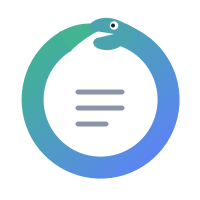
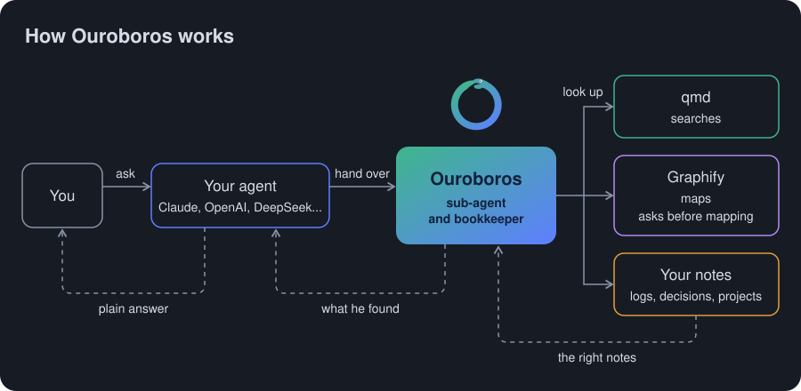
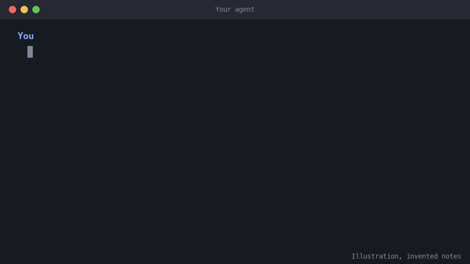
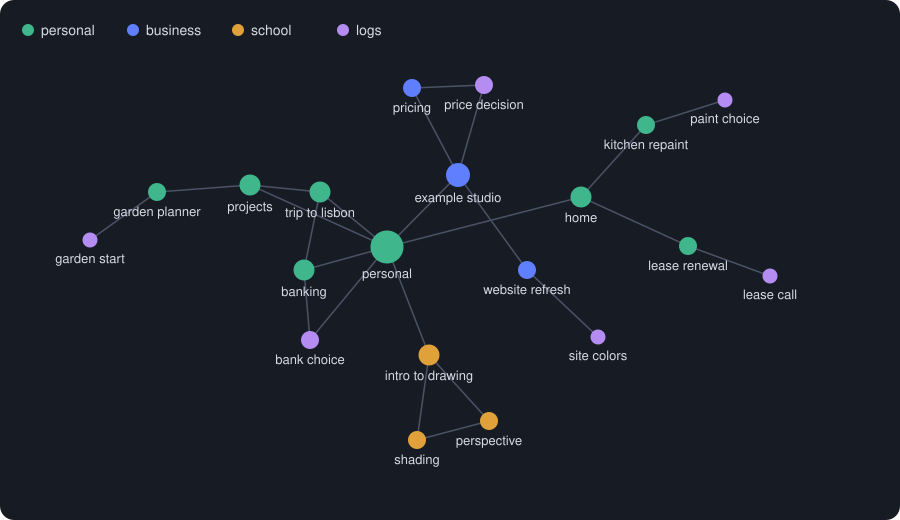

# Ouroboros Notes

**Your notes shouldn't be where ideas go to die.**

Meet **Ouroboros**, the bookkeeper for your second brain. You talk to your own AI in
plain English. It's told to ask Ouroboros, a sub-agent who finds things in your notes,
and it does the logging and filing. It's also told to show you a plan before it moves
anything.

**This is a learning project, not a product.** I wanted to know whether a read-only
helper would save tokens, so I measured it. It didn't.
[Here are the numbers](#-what-i-measured).

## 🚀 Quick start

1. Install an AI agent that can read files and run commands, and sign in. I use
   [Claude Code](https://code.claude.com).
2. Install [Obsidian](https://obsidian.md/).
3. Open your agent, paste this repo's link and say:

       Get Ouroboros working.

4. Read the plan and say yes if you like it. He does the rest, including installing the
   tools. Your agent may ask you to allow some steps.
5. In Obsidian, choose "Open folder as vault" and pick your new notes folder.

Already have notes? Back them up first. Setup asks about every folder and is told to
leave your existing notes alone.

## ⚙️ How it works

*Claude Code can run him as a sub-agent. With an agent that has no sub-agents, it does
his part itself.*

*An illustration of the sub-agent setup with invented notes, not a recording.*

**Why a sub-agent?** In Claude Code, he can read and search your notes but has no tools to
change them. He digs in a chat of his own and his answer comes back to yours. Your agent
does the writing.

**What's in the stack, and why:**

| Piece | Why it's there |
|---|---|
| **Your notes** | Persistent memory: plain files that outlast any chat, with decisions and the reasons logged |
| **Obsidian** | Lets you read, edit and link that memory yourself |
| **Ouroboros** | A read-only helper who looks things up in a chat of his own |
| **qmd** | Finds the right notes on your computer, with private folders left out of its index |
| **Graphify** | A map of how notes connect, if you want one |

*A simplified chart of how your Obsidian may look, with invented notes.*

## 🧪 What I measured

Can a read-only helper look things up for fewer tokens than Claude searching by itself?
Averages per question, on Sonnet 5.5 with invented notes:

| 5 simple questions, 250 notes | Plain Claude | Ouroboros + qmd |
|---|---|---|
| Total tokens | 26,713 | 104,674 |
| Estimated cost | $0.029 | $0.074 |
| Main chat at the start | 4,838 | 13,692 |
| Main chat growth | 4,633 | 1,321 |
| Time to answer | 5 seconds | 18 seconds |
| Right answers | 5 of 5 | 5 of 5 |

| 4 connection questions, 40 linked notes | Plain Claude | Ouroboros + qmd | With a map |
|---|---|---|---|
| Total tokens | 18,302 | 178,156 | 150,102 |
| Estimated cost | $0.019 | $0.148 | $0.132 |
| Main chat at the start | 4,864 | 13,698 | 13,696 |
| Main chat growth | 2,110 | 2,198 | 2,234 |
| Time to answer | 6 seconds | 44 seconds | 38 seconds |
| Right answers | 4 of 4 | 4 of 4 | 4 of 4 |

**What I learned:**

- **He cost more, took longer and was no more accurate.** The main chat grew less on simple questions,
  but not on connection questions.
- **Steps are expensive.** Each one sends his whole chat again. With qmd alone, he took 5
  to 10 steps per connection question and opened notes 6 to 22 times.
- **The map helped a little.** Making it took another 35,585 tokens, and he opened it on 3
  of 4 questions. It was a simpler map than Graphify's usual one.
- **The baseline matters.** Plain search is hard to beat on small notes. Comparing against
  an AI that reads every note would have made any search look good.

**Read these as rough.** Each question ran once per side. The test loaded qmd's tool text
up front and gave plain Claude only three tools, so the gap is probably smaller in normal
use. Small, invented notes say nothing about a large vault.

## 🏁 Outcome

| | What happened |
|---|---|
| Did Claude hand the question to him? | Yes, in all 13 kit and map runs above |
| Did the answer name the notes? | Yes, 13 of 13 |
| Did it say what wasn't checked? | Yes, 13 of 13 |
| Was it quick? | No. Plain search took 5 to 6 seconds, he took 18 to 44 on average |
| Did it save tokens? | No |

| Use it if | Skip it if |
|---|---|
| You want decisions and their reasons written down in plain files | You want the fastest or cheapest lookup |
| You'd like answers that name their notes and their gaps | Plain Claude already does what you need |
| You'd rather your lookup helper had no edit tools (Claude Code) | You want a lock on private files. This isn't one |

**My take:** the writing down is worth more than the helper.

## 👋 A quick note from the author - CoderKola

Hey! Whether you use Claude, OpenAI or any other LLM, you can simply pass this repo to
your agent and it'll set things up with you.

**How I use it:** one main `CLAUDE.md` manages all my sub-agents, and I treat Ouroboros
as one of them, with qmd to find things and Graphify to see how they connect. This is a
clean, shareable version of that idea, so it isn't an exact copy of mine. Experiment
with it and make it yours.

**Want him from other folders too?** Setup connects him in your notes folder only. From
anywhere else, I recommend having your main agent read the `CLAUDE.md` in your notes
folder first. For anything private, open your agent in the notes folder itself: from
anywhere else, it may not ask before opening private files.

**This is a personal experiment for macOS and Linux, so try things with it.** I've
tried the basics on my Mac with Claude Code. If something breaks, tell me. More in
[SECURITY.md](SECURITY.md).

## 🧰 What you get

Any agent, on whatever model you like: Claude, OpenAI, DeepSeek, or something else. A
plain chat window isn't enough.

| | Claude Code | Other agents |
|---|---|---|
| Notes, logs, catching up, filing | Yes | Yes |
| [qmd](https://github.com/tobi/qmd), searches your notes on your machine | Yes | Yes, from the command line |
| [Graphify](https://github.com/Graphify-Labs/graphify), maps how notes connect | Yes | Yes |
| Asks before opening private files | Claude's file reader does | Only if your agent has its own setting |
| Optional reminders and `/log` | Yes | No; just say "log this" |

Setup installs the versions in [VERSIONS.md](VERSIONS.md), after your yes. qmd and
Graphify are other people's projects, so check their
pages first. Don't want one? Say so, and your agent looks through your open folders
itself.

## 🔄 How your AI stays updated with your notes

| | When | Asks you? |
|---|---|---|
| **Search** (qmd) | Before the first search of a session, and when you log or catch up | No. It runs on your computer, with no AI. Your agent may ask you to allow the command |
| **Auto-refresh** (optional) | As often as you choose at setup, while your computer is on and you are logged in. Macs and Linux; a missed nightly or weekly run normally catches up on waking | You choose once, at setup. No AI |
| **Map** (Graphify) | Your agent checks it when you catch up. If ten or more notes changed, or it's over 30 days old, it tells you | Yes, every time. Mapping sends notes to the AI model |

The map isn't set to refresh by itself. Without auto-refresh, search still catches up
when you use it. He's told to do these; they aren't guaranteed, so ask if something seems
out of date.

## 💬 Your first chat

Open your agent in your notes folder, every time, so the rules and any privacy prompts
load. With Claude Code:
`cd ~/path/to/your-notes`, then `claude`. Type `/context all` once: the folder's
`CLAUDE.md` should be listed under Memory files. If not, its rules aren't loaded. If
another agent doesn't know the
rules, tell it to read `AGENTS.md` first.

| Say this | What to expect |
|---|---|
| "What can you and Ouroboros do here?" | Your agent explains who does what |
| "Log this: I set up my notes today." | Your agent writes a log entry |
| "Ask Ouroboros why we picked Bank A." | He finds the note, if you logged one; your agent answers |
| "Catch me up." | A short summary of your logs and open items |
| "File what's in documents/_unsorted." | A suggested name and place, then it waits |
| "Does this need restructuring?" | A plan, or "no change needed" |

**Tip:** end each session with "log this". That's what he can find next time.

## 🔒 Privacy

- Whatever your agent reads goes to whichever company runs the model you chose, and
  through any service your agent uses, possibly in another country. A model that runs
  only on your own computer keeps it there.
- **Private folders are not locked.** Finances, health, client files, the inbox and
  `documents/` start private in a new notes folder. Claude Code's file reader asks first,
  but a command such as `cat` can open a private file without asking. Other agents are
  only told not to.
- He's told to move nothing without a yes and delete nothing. Those are instructions to
  an AI, not locks, so keep a backup. More in [PRIVACY.md](PRIVACY.md).

<b>Optional extras (Claude Code)</b>

Off unless you ask for them. Reminders never save, move or change your notes.

| Extra | What it does | Now? |
|---|---|---|
| Opening reminder | Lists up to three recent logs when Claude opens | Yes |
| Log reminder | Reminds Claude once to offer a log, if notes changed. Needs the opening reminder | Yes |
| Long-chat reminder | Asks Claude to keep decisions and open items when a long chat is shortened | Yes |
| Stricter privacy | Blocks Claude's file tools from private folders instead of asking. You then open, add and edit notes there yourself. Not a full lock: wider searches can still reach them | Yes |

<b>Skills and helper</b>

| Skill | What it does |
|---|---|
| `setup` | Shows the plan, installs the tools and builds your notes folder. Stays in this repo |
| `log` | Records what happened, what was decided and what is open |
| `catch-up` | Summarizes where things stand |
| `file-document` | Suggests a name and place for a file, then waits |

**Same names.** In Claude Code, a personal skill of yours called `log`, `catch-up`,
`file-document`, `setup` or `graphify` runs instead of the one here. If one of yours
answers to "log this" or "catch me up", type `/log` or `/catch-up` to be sure.

**Helper.** `ouroboros` is a read-only agent. He finds notes and past decisions, looks
for duplicates, dead links and clutter, and returns an answer or a plan.

<b>For your agent: how to install this</b>

A link alone loads nothing. After the person agrees, clone this repo to a temporary
folder. Ask them to check the address themselves, since a fork can change any line
here, and use the newest release tag if one exists. Then read `CLAUDE.md` and follow
`.claude/skills/setup/SKILL.md`. The notes go wherever the person chooses, outside
the clone.

<b>License and credits</b>

Free to use, change and share, with credit and under the same license. Please don't
sell it. Using it inside your own business is fine; see [NOTICE.md](NOTICE.md).

| Part | License |
|---|---|
| Everything, unless listed below | [CC BY-NC-SA 4.0](LICENSE) plus [NOTICE.md](NOTICE.md), Copyright 2026 CoderKola |
| Blank note templates | [CC0](vault-template/templates/LICENSE) |

The notes you write are yours.

The decision log follows the long-standing idea of architecture decision records.
Matt Pocock's skills were an influence; the text here is original.

Obsidian, qmd and Graphify are separate projects with their own licenses. Nothing of
theirs is included here. This is a personal project, not affiliated with or endorsed
by them, Anthropic, OpenAI or DeepSeek. Their names and logos belong to their owners.

---

No review proves software is harmless; the files are short, so read them first.
